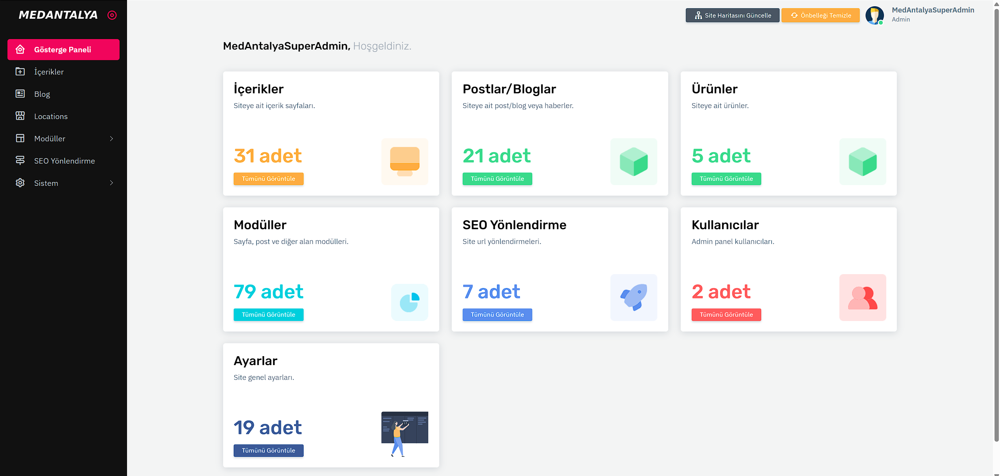
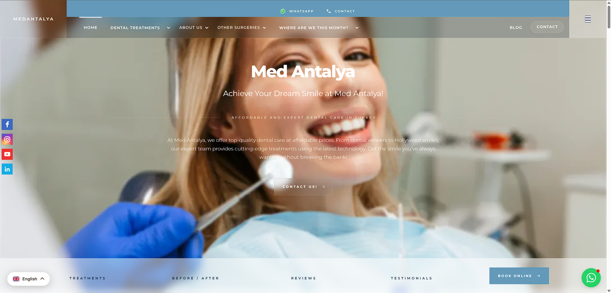

# Laravel CMS Panel

## Türkçe

### Ekran görüntüleri

| Yönetim paneli | Medantalya web sitesi |
|---|---|
|  |  |
Bu depo, `medantalya.com` projesinde kullanılan Laravel yönetim paneli kodlarını içerir. Tek başına çalışan bir Laravel uygulaması değildir; mevcut bir Laravel projesine entegre edilmek üzere hazırlanmıştır. Siteye ait içerik, kullanıcı verisi, veritabanı dökümü, `.env` dosyası, `vendor` ve yüklenmiş dosyalar bu pakete dahil değildir.

## İçindekiler

- Admin giriş ve panel ekranları
- Kullanıcı, rol/izin, dil, içerik, yazı, ürün, modül, ülke/şehir, ayar, iletişim, referans ve SEO yönlendirme yönetimi
- Panel controller, model, yardımcı sınıf, middleware ve Blade görünümleri
- Panelin statik CSS/JS/font kaynakları
- Medantalya panelinin veritabanı migration ve başlangıç seeder dosyaları

Bu kod Medantalya projesinden çıkarılmıştır. Başka bir web sitesine eklemeden önce ihtiyaç olmayan modülleri kaldırın, panel menüsünü ve alanlarını hedef projenin model/veritabanı yapısına uyarlayın.

## Gereksinimler

- Laravel 10.x ve projedeki Composer bağımlılıkları
- PHP sürümü ve uzantıları, hedef Laravel uygulamasının gereksinimlerini karşılamalıdır
- Panel dosyalarının kullandığı `laravel/ui`, `unisharp/laravel-filemanager` ve diğer paketlerin hedef projede kurulmuş ve yapılandırılmış olması
- Dosya yöneticisi için erişim denetimi ve güvenli yükleme ayarlarının gözden geçirilmesi

Paket, kaynak projedeki `composer.json` dosyasını içermez; çünkü bu bağımlılıkların sürümleri hedef uygulamanın mevcut Laravel sürümüyle birlikte değerlendirilmelidir.

## Entegrasyon

1. Hedef Laravel projesinin yedeğini alın ve çalıştığı Laravel sürümünü doğrulayın.
2. Bu depodaki dosyaları hedef projenin aynı göreli yollarına kopyalayın. Önce Git dalında deneyin; aynı isimli dosyaları körlemesine ezmek yerine değişiklikleri karşılaştırıp birleştirin.
3. `routes/panel.php` içeriğini hedef projenin route yapılandırmasına dahil edin. Projedeki `RouteServiceProvider` bu dosyayı otomatik yüklemiyorsa panel route dosyasını ayrıca yükleyin.
4. Hedef `app/Http/Kernel.php` içine panelin kullandığı `auth.status` ve `auth.permission` middleware alias'larını ekleyin. Çakışan veya Laravel sürümünde değişmiş middleware kayıtlarını uyarlayın.
5. `config/auth.php` içindeki guard/provider ayarlarını ve kullanıcı modelini inceleyin. Panel `App\Models\Panel\User` modelini kullanır; hedef uygulamada mevcut kullanıcı tablosu ile uyumlu hale getirin.
6. Panel migration dosyalarını inceleyin. Tablo adları ve ilişkileri hedef veritabanıyla çakışmıyorsa, önce boş bir geliştirme veritabanında migration çalıştırın. Üretim veritabanında yedeksiz migration çalıştırmayın.
7. `database/seeders` içindeki gerekli başlangıç verilerini inceleyin. Kaynak projedeki kullanıcı/rol başlangıç seeder'larını doğrudan çalıştırmayın; yönetici hesabını güvenli ve projeye uygun bir yöntemle oluşturun.
8. Panelin dosya seçicisi, `public/panel` varlıkları ve Laravel File Manager kullanımı için paket, disk, URL ve izin ayarlarını hedef projede yapılandırın.
9. Giriş adresini `/admin/login` üzerinden açın. İlk yönetici hesabı oluşturma, parola sıfırlama, rol/izinler ve üretim güvenlik ayarlarını doğrulayın.

## Uyarlama notları

- Panel, kaynak projedeki `App\\Helpers\\Helpers.php` dosyasını Composer autoload üzerinden yükleyecek biçimde kullanır. Hedef projedeki `composer.json` dosyasına gerekirse `autoload.files` kaydı ekleyip `composer dump-autoload` çalıştırın.
- Controller'lar bazı ortak trait ve helper sınıflarına, modeller de panel tablolarına bağlıdır. Yalnızca tek bir modülü kopyalamak genellikle yeterli olmaz.
- Admin rotaları `auth`, `auth.status` ve `auth.permission` kontrolleri kullanır. Bu kontrollerin hedef uygulamada doğru kaydedildiğini ve erişim kurallarının test edildiğini doğrulayın.
- Kaynak projedeki tema, site ayarları, e-posta, logo, locale ve dosya yolu değerleri hedef siteye göre değiştirilmelidir.
- Panel arayüzündeki metinler ve bazı alanlar Medantalya'nın ihtiyaçlarına göre hazırlanmıştır; genel amaçlı bir paket olarak kabul edilmemelidir.

## Güvenlik

`.env`, veritabanı yedeği, gerçek kullanıcı kayıtları veya parolalar bu depoya eklenmemelidir. Yayınlamadan önce GitHub deposunun içeriğini ve dosya geçmişini kontrol edin; bir gizli anahtar geçmişte paylaşıldıysa anahtarı iptal edip yenileyin. Üretimde `APP_DEBUG=false` kullanın, HTTPS etkinleştirin ve yönetici hesaplarında benzersiz güçlü parolalar belirleyin.

## Lisans

Bu paket için henüz ayrı bir açık kaynak lisansı seçilmemiştir. GitHub'da **public** yayınlamak, başkalarına kodu kullanma, değiştirme veya dağıtma izni veren bir lisansın yerine geçmez. Yayınlamadan önce size ait olmayan tema, font, görsel ve paket varlıklarının lisanslarını inceleyip uygun bir lisans dosyası ekleyin. Lisanssız public depoda başkalarının kullanım hakları açıkça verilmiş olmaz.

---

## English

This repository contains the Laravel admin panel code used by `medantalya.com`. It is not a standalone Laravel application; it is intended to be integrated into an existing Laravel project. Site content, user data, database dumps, the `.env` file, `vendor`, and uploaded files are not included.

## What's included

- Admin login and panel screens
- Management for users, roles and permissions, languages, content, posts, products, modules, countries and cities, settings, contacts, testimonials, and SEO redirects
- Panel controllers, models, helper classes, middleware, and Blade views
- Static CSS, JavaScript, and font assets used by the panel
- Database migrations and initial seeders from the Medantalya panel

This code was extracted from the Medantalya project. Before integrating it into another website, remove modules you do not need and adapt the panel menu and fields to the target project's models and database structure.

## Requirements

- Laravel 10.x and the project's Composer dependencies
- A PHP version and extensions that meet the target Laravel application's requirements
- The packages used by the panel, including `laravel/ui` and `unisharp/laravel-filemanager`, installed and configured in the target project
- Reviewed access controls and secure upload settings for the file manager

The source project's `composer.json` is not included because dependency versions must be evaluated against the Laravel version already used by the target application.

## Integration

1. Back up the target Laravel project and confirm its Laravel version.
2. Copy files from this repository to the same relative paths in the target project. Try this on a Git branch first; compare and merge changes instead of blindly overwriting files with matching names.
3. Include `routes/panel.php` in the target project's route configuration. If its `RouteServiceProvider` does not load this file automatically, load the panel routes separately.
4. Register the panel's `auth.status` and `auth.permission` middleware aliases in the target `app/Http/Kernel.php`. Adapt registrations that conflict with the target app or have changed between Laravel versions.
5. Review the guards and providers in `config/auth.php` and the user model. The panel uses `App\Models\Panel\User`; make it compatible with the user table in the target application.
6. Review the panel migration files. If table names and relationships do not conflict with the target database, run the migrations first against an empty development database. Do not run migrations on a production database without a backup.
7. Review the required initial data in `database/seeders`. Do not run the source project's user or role seeders as-is; create the administrator account using a secure method suited to the target project.
8. Configure the package, disk, URL, and permissions required by the panel's file picker, `public/panel` assets, and Laravel File Manager.
9. Open `/admin/login`. Verify administrator account creation, password reset, roles and permissions, and production security settings.

## Adaptation notes

- The panel expects Composer autoload to load the source project's `App\Helpers\Helpers.php`. If needed, add an `autoload.files` entry to the target project's `composer.json` and run `composer dump-autoload`.
- Controllers depend on shared traits and helper classes, and models depend on the panel tables. Copying only one module is usually not enough.
- Admin routes use the `auth`, `auth.status`, and `auth.permission` checks. Confirm these checks are registered correctly and access rules have been verified in the target application.
- Update theme, site settings, email, logo, locale, and file path values for the target website.
- Some panel labels and fields were designed for Medantalya's needs; this should not be treated as a generic, plug-and-play package.

## Security

Do not add `.env` files, database backups, real user records, or passwords to this repository. Before publishing, review the GitHub repository contents and history. If a secret was ever committed, revoke and replace it. Use `APP_DEBUG=false` in production, enable HTTPS, and set unique, strong passwords for administrator accounts.

## License

No separate open-source license has been selected for this package yet. Making a GitHub repository **public** does not grant others the rights to use, modify, or distribute the code. Before publishing, review the licenses for themes, fonts, images, and package assets you do not own, and add an appropriate license file. Without a license, other people's rights to use the repository are not explicitly granted.
